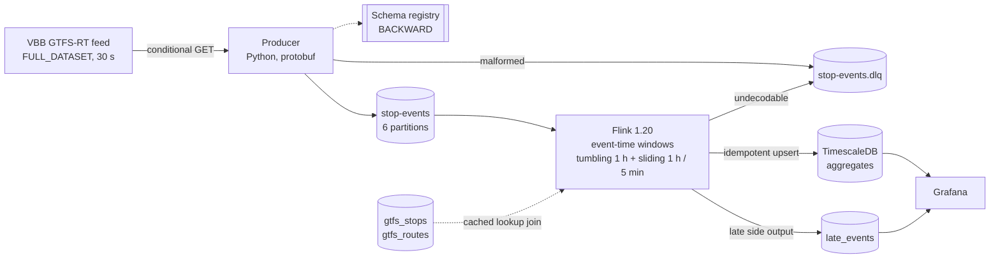

# Berlin transit delay stream

A real-time pipeline over the VBB/BVG GTFS-Realtime feed. It computes
punctuality metrics by line, station and hour on **event time**, and serves
them on a live dashboard. Everything runs locally under `docker compose` on a
laptop with 8 GB of RAM.



## Quick start

Docker Desktop needs **6 GB** allocated (Settings, Resources, Memory). The
default on Windows is half of system RAM, and at 4 GB the Flink job manager
is killed by the OOM killer while building the job graph.

Set `POSTGRES_PASSWORD` in `.env` to letters and digits only. A `#` or `@` in
the password breaks every connection URL in the stack, because `#` starts a
URL fragment.

macOS and Linux:

```bash
cp .env.example .env            # set POSTGRES_PASSWORD
make up                         # builds and starts everything
make seed-gtfs                  # loads stop and route names, about a minute
make compat                     # pins the schema subject to BACKWARD
```

Windows has no `make`, so call compose directly:

```bat
copy .env.example .env
docker compose up -d --build
docker compose run --rm gtfs-loader
docker compose run --rm -e SCHEMA_REGISTRY_URL=http://redpanda:8081 producer python /app/tools/set_compatibility.py
```

The first build compiles the Flink job with Maven and takes 5 to 10 minutes.

Then open the Flink UI at <http://localhost:8083> and Grafana at
<http://localhost:3000> (admin / admin). The dashboard fills in as the first
hour of event time closes.

`make help` lists every target. `docs/architecture.md` has the compose
topology if you prefer raw `docker compose` commands throughout.

## Headline numbers

Measured properties of the source feed, from a live snapshot on
2026-10-02 21:37 UTC:

| Property | Value |
| --- | --- |
| TripUpdate entities per snapshot | 5021 |
| StopTimeUpdates per snapshot | 82892 |
| Snapshot size | about 32 MB as JSON |
| Poll interval | 30 s |
| Authentication | none, CC BY 4.0 |

Pipeline numbers, to be filled in from a real 24 hour run. They are blank on
purpose: see [docs/proofs.md](docs/proofs.md) for the procedure that produces
each one.

| Metric | Value |
| --- | --- |
| Sustained throughput, natural rate | |
| Sustained throughput, 10x load test | |
| p99 end-to-end latency, producer to sink | |
| Peak consumer lag under 10x load | |
| Late-record rate | |
| Delay coverage (share of events carrying a delay) | |

## What this demonstrates

| Requirement | Where it lives |
| --- | --- |
| Protobuf on the wire, schema registry, explicit evolution handling | [`proto/delay/v1/stop_event.proto`](proto/delay/v1/stop_event.proto), `producer/src/bvg_producer/registry.py`, `flink-job/.../ConfluentWireFormat.java` |
| Delay by line, station and hour on event time | `flink-job/.../DelayPipeline.java`, `window/` |
| Watermarks, allowed lateness, late records captured not dropped | `DelayPipeline.watermarkStrategy`, `LATE_TAG`, `late_events` table |
| Tumbling and sliding windows side by side | `delay_tumbling_1h` and `delay_sliding_1h_5m`, both on the dashboard |
| Idempotent upsert sink | `sink/BatchedUpsertSink.java` |
| Dead letter topic | `stop-events.dlq`, written by both the producer and the job |
| Checkpointing with documented recovery | [docs/recovery-semantics.md](docs/recovery-semantics.md) |

## Three design decisions worth knowing before you read the code

**Event time is the stop time, not the entity timestamp.** Entity timestamps
inside one VBB snapshot span more than four hours. Using them would force a
watermark lag of hours. The producer emits only stop events whose reported
time is at or before the feed header timestamp, and that time is the event
time. Full reasoning in [docs/architecture.md](docs/architecture.md).

**There are no vehicle positions in this feed.** Every entity is a
`trip_update`; the upstream VDV-454 source carries no coordinates. The project
therefore measures punctuality and does not plot vehicles.

**Delay comes from the feed, not from a join against the schedule.** A large
share of stop time updates carry a time but no delay, and zero is a real
value, so absence is carried explicitly in `has_delay`. Joining against
`stop_times.txt` would be more complete and would also mean tens of millions
of rows on a laptop. The coverage ratio is exported as a metric so the cost of
that choice is visible rather than assumed.

## Repository layout

```
proto/            StopEvent schema, shared by the producer and the job
producer/         Python producer: poll, transform, publish, record
flink-job/        Flink 1.20 job in Java 17
tools/            GTFS loader, load generator, lag probe, replay verifier
sql/              Sink schema, applied on first database boot
grafana/          Provisioned datasource and dashboard
docs/             Architecture, recovery semantics, proofs
```

## Tests

```bash
make test         # producer suite and Flink job suite
make lint         # ruff and mypy over the Python sources
```

CI runs both suites plus a compose validation on every push.

## Known limitations

These are real and they are listed because an interviewer will find them
anyway.

1. **Delay coverage is partial.** Events without a feed-supplied delay are
   counted and excluded from the aggregates. The averages describe the
   subset of stop events that carry a delay, not every stop event. Fixing it
   means importing `stop_times.txt` and joining, which this deployment
   deliberately does not do.
2. **No vehicle positions.** Not a design choice, a property of the feed.
3. **The job manager has no high availability.** Killing the task manager
   recovers automatically; killing the job manager needs the manual restore
   documented in [docs/recovery-semantics.md](docs/recovery-semantics.md).
   HA would cost another container and several hundred megabytes.
4. **The sink is effectively exactly once, not transactionally exactly
   once.** Rows can be written twice, and both writes store the same values.
   A two-phase commit sink would make it literal and would add a transaction
   coordinator to a laptop deployment.
5. **Replay determinism depends on `SOURCE_IDLE_TIMEOUT_S` staying at zero.**
   Source idleness advances watermarks from wall clock. Turning it on buys
   liveness on a quiet night network and costs the bit-identical replay
   guarantee.
6. **Checkpoint storage is a local volume.** Fine for one machine, useless for
   a real cluster, where this would be object storage.
7. **One Postgres connection per sink subtask, no pool.** At the volumes here
   a pool would add a dependency and no measurable benefit. At ten times this
   volume the sink is the first thing that will need attention; see
   [docs/proofs.md](docs/proofs.md).
8. **Berlin only by default.** `STOP_ID_PREFIX=de:11000:` keeps the volume and
   the memory inside the laptop budget. Setting it empty ingests all of
   Berlin and Brandenburg.
9. **The dashboard shows the aggregates, not the raw stream.** There is no
   per-trip drill-down; the raw events live in Kafka only, for the topic
   retention period of 48 hours.
10. **The late-record count spikes on a cold start.** When the job starts
    against a topic that already holds a backlog, the watermark jumps to the
    newest event in the first batch, so the older events behind it are late by
    definition. The side output catches them, which is the point, but the
    late rate in the first minutes of a run is an artifact of catching up and
    not a property of the feed. Read it after the job has been live for an
    hour.

## Attribution and licence

Transit data: VBB Verkehrsverbund Berlin-Brandenburg GmbH, licensed
CC BY 4.0. The feed and the GTFS Schedule export are published at
<https://unternehmen.vbb.de/digitale-services/datensaetze/>.
