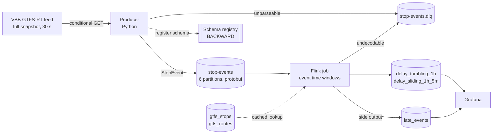

# Architecture

## The data source

VBB publishes a GTFS-Realtime feed at `https://production.gtfsrt.vbb.de/data`.
No API key, no registration, CC BY 4.0, attribution string
"VBB Verkehrsverbund Berlin-Brandenburg GmbH". A staging copy of the same feed
lives at `https://staging.gtfsrt.vbb.de/data`. The feed is generated by
[OpenDataVBB/gtfs-rt-feed](https://github.com/OpenDataVBB/gtfs-rt-feed), which
matches VDV-454 realtime messages against GTFS Schedule.

Measured from a live snapshot on 2026-10-02 at 21:37 UTC:

| Property | Value |
| --- | --- |
| `header.incrementality` | `FULL_DATASET` (0), a complete snapshot every poll |
| TripUpdate entities | 5021 |
| StopTimeUpdates | 82892 |
| Snapshot size | about 32 MB as JSON, a few MB as protobuf |
| Entity timestamp spread inside one snapshot | 17:26 UTC to 21:38 UTC |
| VehiclePositions | none, the feed carries TripUpdates only |
| `vehicle` descriptor, `trip.start_time`, `TripUpdate.delay` | absent |

Three properties of this feed drove the whole design.

### 1. There are no vehicle positions

Every entity is a `trip_update`. The upstream source is VDV-454 `AUS` data,
which has no coordinates, so no amount of configuration will produce a
VehiclePositions feed here. The pipeline therefore computes punctuality
metrics and does not plot moving vehicles.

### 2. Event time is the stop time, not the entity timestamp

Entity timestamps inside a single snapshot span more than four hours. Using
them as event time would force a watermark lag of hours, and every window
would be either permanently open or permanently late.

The pipeline instead uses the stop event's own reported time, and the producer
only emits stop events whose time is at or before the feed header timestamp.
A prediction for a stop in the future is not an observation; once the snapshot
clock passes that time, the same stop becomes one. Out-of-orderness drops from
hours to minutes, and late data arises naturally when a later snapshot
restates a stop whose window has already closed.

### 3. Why delay comes from the feed

`StopTimeEvent.delay` is optional and is missing on a large share of the feed.
Zero is also a real and common value, so absence cannot be encoded as zero.
The producer carries presence explicitly in `has_delay`, and the job drops
events without it from the aggregates and counts them.

The alternative is to join every stop event against `stop_times.txt` from the
GTFS Schedule export and compute the delay directly. That join is correct and
it is what a production system with a server would do. It is also tens of
millions of rows and several gigabytes of index for the VBB network, which
does not belong on an 8 GB laptop. The honest trade is written down here, the
coverage ratio is exported as a metric (`bvg_delay_coverage_ratio`), and the
limitation is repeated in the README rather than buried.

Only `stops.txt` and `routes.txt` are loaded, for human readable names. Both
are small, and the lookup join against them is cached.

## Shape of the pipeline

## Component notes

### Producer

Polls with a conditional GET, so an unchanged snapshot costs a 304 and no
body. Errors are split into retryable and fatal at the point they are raised,
so the main loop never inspects error strings: timeouts, connection failures,
429 and 5xx back off exponentially with jitter, while 401, 403 and 404 exit
non-zero.

Messages are keyed by trip instance (`trip_id|start_date`), which keeps every
event of one trip in one partition and in order. The stop is deliberately not
part of the key: per-trip ordering is what the windowing needs.

The producer writes every raw snapshot to a volume. That recording is what
makes the replay proof and the load test run against real traffic.

### Serialisation and schema evolution

Messages are protobuf, framed in the Confluent wire format, with the schema
registered in Redpanda's Confluent-compatible registry under
`stop-events-value` at BACKWARD compatibility.

The Flink job parses the five byte header itself and then uses its own
compiled class. It never fetches a schema. That is deliberate: under BACKWARD
compatibility a consumer compiled against an older copy of the schema skips
fields it does not know, so a producer-first rollout is safe without a
registry round trip on the hot path. The writer schema id is still read and
exported as a gauge, so a rollout is visible while it happens.

The evolution rules themselves live as comments in
[`proto/delay/v1/stop_event.proto`](../proto/delay/v1/stop_event.proto), and
`make compat` pins the registry setting that enforces them.

### Windows

Both windows run on event time over the same keyed stream, keyed by route and
stop:

- tumbling, one hour: the headline "delay by line, station and hour" number.
- sliding, one hour every five minutes: twelve overlapping readings per hour.
  The same traffic, smoothed, which is what makes the difference between the
  two assigners visible in the dashboard rather than theoretical.

Watermarks are bounded out-of-orderness, five minutes by default. Source
idleness is **off** by default. Idleness advances a watermark because nothing
arrived, which is a processing-time input, and that would make a replay
produce different window contents from the original run. `SOURCE_IDLE_TIMEOUT_S`
turns it on for anyone who prefers liveness on a quiet night network and
accepts that the replay proof no longer holds bit for bit.

Allowed lateness is ten minutes. Records later than that go to a side output
and are written to `late_events` with their measured lateness, so the
allowed-lateness setting can be argued from data instead of taste.

### Sink

Plain JDBC, batched, flushed on every checkpoint barrier. Every statement is
an upsert whose conflict target is the window identity, so writing the same
window twice stores the same values. That is what makes replay reproducible
and what makes checkpoint recovery free of duplicates without a distributed
transaction. The reasoning is in
[recovery-semantics.md](recovery-semantics.md).

TimescaleDB rather than ClickHouse for exactly this reason: `ON CONFLICT DO
UPDATE` is idempotent at write time, while `ReplacingMergeTree` deduplicates
eventually and needs `FINAL` at read time, which would put an asterisk on the
replay proof.

### Memory budget

Sized for a laptop with 8 GB of RAM. Limits are set per service in the compose
file, not left to chance.

| Service | Limit |
| --- | --- |
| Redpanda | 1200 MB |
| Flink task manager | 1700 MB |
| Flink job manager | 1200 MB |
| TimescaleDB | 700 MB |
| Producer | 300 MB |
| Grafana | 250 MB |
| **Default profile total** | **about 4.8 GB** |

The lag probe (200 MB) and the load generator (400 MB) sit in optional
compose profiles, so they only cost memory while a proof is running.

Docker Desktop itself must be given at least 6 GB. The job manager was
originally sized at 600 MB of process memory and died with an
`OutOfMemoryError` while building the job graph; 1024 MB is the measured
floor for Flink 1.20 in application mode with this job.

Redpanda rather than Kafka plus a separate Confluent Schema Registry: one
process instead of two, with the registry built in, which is worth roughly
1.5 GB on this budget. The Kafka protocol is the same, so nothing in the job
knows the difference.
